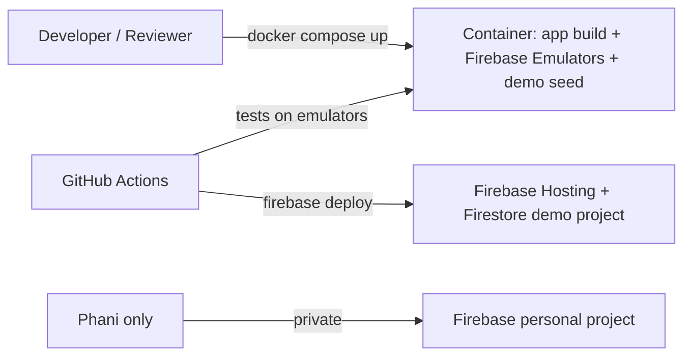

# Daily Planner Web App: Functional Specification

**Project:** AI Dev Tools Zoomcamp, Project 2 (Attempt 2), due Tue 17 Nov 2026, 4:30 AM IST
**Owner:** A S V N Phanindra (Phani)
**Status:** Draft v0.3, 9 Nov 2026 (Firestore, privacy and Docker decided)
**Goal:** Replace today's static PNG planner with an interactive web app where tasks can be planned, moved, tracked, and reviewed.

---

## 1. Problem

Today the planner is a Python script that renders an image each morning. It works as a view, but:

- Any change (a substitute class, a holiday, an appointment) has to be requested and then the whole image is regenerated.
- Tasks cannot be dragged, resized, or marked done directly.
- There is no history of what got done, which makes the every-3-weeks PhD status update harder to write.
- Productivity bands, life areas, and recurring rules live in code instead of in data the user can edit.

## 2. Users and usage

- **Primary user:** one person (Phani), an associate professor and PhD student.
- **Devices:** laptop (main planning), phone (quick check and marking done on the bus or on campus).
- **Time zone:** all times are shown and stored in IST (Asia/Kolkata).

## 3. Core concepts (data model)

| Concept | Description |
|---|---|
| **Life area** | One of four categories, each with a colour: Job (blue), PhD (purple), Family (green), Passion (orange). |
| **Task** | Something to do. Has title, life area, optional notes, estimated duration, priority, optional due date/time, status. |
| **Time block** | A task (or routine) placed on a specific date with start and end time. |
| **Routine block** | Fixed daily items shown as plain grey blocks: bus, breakfast, lunch, dinner, sleep, etc. Meals are labelled. |
| **Class** | Teaching slot from the timetable: section (Sec 19, 20, 21...), period, room/lab, weekday. |
| **Day type** | Normal, Holiday, No classes (e.g. Freshers Day), Online (e.g. elections), Exam day. Controls whether campus classes and bus blocks appear. |
| **Productivity band** | Energy level for a time range: High, Medium, Medium-low, Low. Shown as a colour strip beside the time column. |
| **Goal** | A weekly goal (e.g. "Review 5 PhD sections") linked to one life area and optionally to tasks. |
| **Event / deadline** | A dated item for the calendar: project deadlines, exams, family events, academic dates, recurring series (bike service, PhD status). |

## 4. Functional requirements

### 4.1 Day and week view (replaces the PNG)

- FR-1: Show a rolling 7-day grid (3 past days + today + 3 upcoming), 6 AM to 11 PM, in 30-minute rows (zoom to 15 minutes optional).
- FR-2: Today's column is highlighted; past days are dimmed.
- FR-3: Blocks are coloured by life area; routine blocks are grey; class blocks are coloured by section.
- FR-4: A productivity band strip runs beside the time column:
  - High (green): 7:00–7:45 AM, 8:15–8:30 AM (first 15 min of morning bus), 9:00 AM–12:00 PM
  - Medium (amber): 12:30–4:30 PM, 8:00–9:30 PM
  - Medium-low: evening bus 4:40–5:45 PM
  - Low (grey): everything else (meals, bus, after 9:30 PM)
- FR-5: Show a "Last updated" timestamp in IST.
- FR-6: Switch between Day, Rolling week, and Month views.

### 4.2 Planning tasks

- FR-7: Create, edit, and delete tasks quickly (title, area, duration, due date, notes).
- FR-8: Drag a task from the backlog onto the grid to create a time block; drag to move; resize to change duration.
- FR-9: Warn on conflicts (overlap with a class, meal, appointment, or another block) and offer to shorten or move the other item (e.g. shorten dinner on an appointment evening).
- FR-10: Warn when a task's depth does not match the band (e.g. writing work placed on the bus). Bus slots accept only listening or quick-review tasks.
- FR-11: Campus PhD slots (9:20 AM–4:30 PM) are marked "optional"; main PhD slots are suggested at 7:00–7:45 AM or 8:00–9:30 PM.

### 4.3 Daily rules

- FR-12: Every day must contain a **1.5 h PhD deep-focus block** (clock time flexible). The app shows a warning badge on any day missing it.
- FR-13: Every day has a **1.5 h flexible block** (trainings, passion, family, class prep). Project work goes after the PhD block.
- FR-14: The app never auto-places these blocks without confirmation. It may *suggest* slots ("Place PhD at 8:00–9:30 PM?") that the user accepts with one click.

### 4.4 Status tracking

- FR-15: After a block's end time passes, it asks: **Done / Partly done / Not done**. Nothing is assumed complete.
- FR-16: "Partly done" and "Not done" tasks go back to the backlog with a "replan" flag and remaining-time estimate.
- FR-17: Optional evening energy tag per day (high / medium / low) to refine bands later.
- FR-18: End-of-day summary at about 9:20 PM: planned vs done, per life area.

### 4.5 Focus tasks and weekly goals

- FR-19: A Focus Tasks panel with four columns (Job, PhD, Family, Passion), each holding current standing tasks (e.g. "Deep focus · 1.5 h daily", "Status update · every 3 weeks", "Exercise · 2 x 20 min daily").
- FR-20: Weekly goals (Mon–Sun) are starred and show progress. Example for 9–15 Nov 2026:
  - Passion: Finish AI Dev Tools Project 2 (due 17 Nov, 4:30 AM)
  - PhD: Complete reviewing 5 sections
  - Family: SH-9 document sign (Wed 11 Nov, 7:00 PM)
- FR-21: Unfinished goals can be carried over to next week in one click.

### 4.6 Timetable and day types

- FR-22: Store the weekly teaching timetable (periods, sections, labs) once; classes appear automatically on the grid. **MVP: no import or edit screen; the timetable is seeded directly in Firestore (console or `seed` script).**
- FR-23: One-off changes: substitute class (e.g. Sec 20, 3:25–4:25 PM), cancelled class, extra class. If a change is ambiguous (extra vs replacement), the app asks.
- FR-24: Mark a date as Holiday, No classes, Online, or Exam day. Holiday and No classes remove campus and bus blocks; Online keeps listed online slots, greys usual classes, and removes the bus.
- FR-25: Tutorial hours available for use are highlighted (e.g. Sec 21 Mon P2, Sec 19 Tue P4, Sec 20 Tue P6).

### 4.7 Calendar (next 3 months)

- FR-26: A 3-month mini calendar with coloured markers by type: PhD Status, Bike service, Exam, Project, Family, Academic; current week highlighted.
- FR-27: Recurring series: PhD status every 3 weeks; bike servicing every 4 months on the 24th.
- FR-28: A list of upcoming dated items under the calendar.
- FR-29: Items can be paused (e.g. a paused course), which hides its tasks without deleting them.

### 4.8 Reminders

- FR-30: Reminder before a timed event (default 1 h, configurable), shown as an in-app / browser notification **while the app is open** (free Spark plan). Push to a closed phone needs scheduled Cloud Functions (Blaze plan) and is out of scope.
- FR-31: Morning digest (6:00 AM): today's blocks, classes, and deadlines.

### 4.9 PhD status report helper

- FR-32: Log a short note when a PhD block is marked done.
- FR-33: "Generate status update" builds a summary of all PhD notes since the last status date, ready to copy.

## 5. Non-functional requirements

- NFR-1: Responsive; usable on a phone for viewing and marking done.
- NFR-2: All times in IST; dates stored as ISO.
- NFR-3: Data persists in **Cloud Firestore** (document database), hosted on Firebase. Use the Firestore Emulator for local dev and tests.
- NFR-4: Fast: a drag or edit reflects in under 200 ms.
- NFR-5: **Single user only** (no sharing), signed in with **Firebase Authentication** (Google sign-in). Firestore security rules allow reads and writes only for the owner's uid.
- NFR-7: Must run on the **Firebase free (Spark) plan**. Anything needing Blaze (scheduled functions, outbound network calls) is optional.
- NFR-6: Export/import JSON; export the week view as PNG for sharing.

## 5a. Firestore data model

Everything lives under the signed-in user, so security rules stay simple: `users/{uid}/...`. Documents are small and read by date range.

| Collection | Doc id | Key fields |
|---|---|---|
| `users/{uid}` | uid | name, timezone (`Asia/Kolkata`), settings (default reminder minutes) |
| `areas` | `job`, `phd`, `family`, `passion` | name, colour, order |
| `bands` | auto | level (high/medium/medlow/low), start `HH:mm`, end `HH:mm`, weekdays |
| `routines` | auto | label, start, end, weekdays, showLabel (meals true) |
| `timetable` | auto | section, period, start, end, weekday, kind (lecture/lab/tutorial), room |
| `dayTypes` | `YYYY-MM-DD` | type (normal/holiday/noClasses/online/exam), label, onlineSlots[] |
| `classChanges` | auto | date, kind (substitute/cancel/extra), section, start, end, note |
| `tasks` | auto | title, areaId, durationMin, priority, due (timestamp), status (backlog/planned/done/partly/notDone), remainingMin, notes, goalId?, paused |
| `blocks` | auto | taskId?, date `YYYY-MM-DD`, start, end, areaId, status, statusAskedAt, note |
| `goals` | `YYYY-Www-n` | week (`2026-W46`), areaId, title, starred, progress, carriedFrom? |
| `focusTasks` | auto | areaId, title, subtitle, order |
| `events` | auto | date, endDate?, kind (exam/project/family/academic/series), label, time?, seriesId? |
| `series` | auto | label, kind, rule (every 3 weeks / every 4 months on 24th), startDate, paused |
| `phdLogs` | auto | date, blockId, note |
| `dailyLogs` | `YYYY-MM-DD` | energy (high/medium/low), summary {area: plannedMin, doneMin} |

Design notes:
- Store dates as `YYYY-MM-DD` strings and times as `HH:mm` strings in IST, so range queries by `date` are simple and no time-zone shifting happens.
- Query the week view with `blocks where date >= from and date <= to` (one composite index on `date`, `start`).
- Denormalise `areaId` and title onto `blocks` so the grid renders from one query.
- Recurring series are expanded on read (client or function), not stored as many copies.
- Composite indexes go in `firestore.indexes.json`; rules in `firestore.rules`, both in the repo.

## 5b. Privacy: reviewers never see personal data

The project is submitted for peer review, so the repo and the demo must not contain any real personal data.

- **Two Firebase projects:** `planner-demo` (public demo, sample data only) and `planner-personal` (real use, never shared). The repo's `.firebaserc` points to the demo project by default.
- **No personal data in git:** real timetable, names, family events, PhD notes are never committed. `.env*`, `seed/personal/`, and service-account keys are in `.gitignore`.
- **Sample seed data:** `seed/demo/*.json` holds fictional data (e.g. "Teacher A", sections "Sec A/B/C", generic events like "Project deadline", "Doctor appointment"). The `seed` script loads it into the emulator or the demo project.
- **Personal seed** is loaded only by the owner, locally, with `npm run seed:personal` from an ignored folder.
- **Demo login:** the demo deploy uses Firebase Anonymous Auth (or a demo Google account) so reviewers can try it without seeing anyone's data; security rules still scope data per uid.
- **README screenshots** are taken from the demo data only.

## 5c. How Docker fits with Firebase hosting

Firebase Hosting serves the built static files, so production does not run a container. Docker is used for **reproducible local runs and review**:

- `Dockerfile` builds the frontend and installs `firebase-tools` (Node + Java for the emulators).
- `docker-compose.yml` starts one service that runs the **Firebase Emulator Suite** (Hosting, Firestore, Auth, Functions) and loads `seed/demo` on start.
- Reviewers run `docker compose up` and open `http://localhost:5000` (app) and `http://localhost:4000` (Emulator UI). No Firebase account or cloud access needed, and only demo data exists.
- The same image runs tests in CI (GitHub Actions) against the emulators.
- Production: `firebase deploy` from CI (or locally) to Hosting + Firestore on the Spark plan.

## 6. Suggested tech (fits the Zoomcamp project requirements)

- Frontend: React + TypeScript (or similar), a calendar/grid component with drag and drop.
- Hosting: **Firebase Hosting** for the frontend.
- Database: **Cloud Firestore** (document database), with offline persistence so the phone view works on the bus.
- Backend logic: **Cloud Functions for Firebase** for rules that should not live in the browser (daily PhD-block check, end-of-day summary, recurring series expansion, reminders via scheduled functions). Expose them as HTTPS endpoints with an OpenAPI spec if the course needs a documented API.
- Auth: Firebase Authentication.
- Docker: see section 5c (local run and review via the Emulator Suite).
- Tests: unit tests for rules (daily PhD block, conflicts, day types); integration tests against the Firebase Emulator Suite (Firestore, Auth, Functions); security-rules tests.
- CI with GitHub Actions running tests on the emulators (inside the Docker image), then `firebase deploy` to the demo project on merge to main.
- Document AI-assisted development (prompts, tools, MCP) in the README as the course expects.

## 7. MVP scope (for the 17 Nov deadline)

Must have: FR-1 to FR-3, FR-5, FR-7, FR-8, FR-9, FR-12, FR-14, FR-15, FR-16, FR-19, FR-20, FR-22, FR-24, FR-26, NFR-2, NFR-3.

Later: bands auto-refinement, reminders and digest, PhD status generator, PNG export, mobile polish.

## 8. Example API (draft, Cloud Functions or direct Firestore access)

| Method | Path | Purpose |
|---|---|---|
| GET | /api/days?from=&to= | Day types, classes, blocks for a range |
| POST | /api/tasks | Create task |
| PATCH | /api/tasks/{id} | Edit task |
| POST | /api/blocks | Place a task on the grid |
| PATCH | /api/blocks/{id} | Move / resize / set status |
| GET | /api/goals?week= | Weekly goals with progress |
| PUT | /api/day-types/{date} | Mark Holiday / No classes / Online / Exam |
| GET | /api/events?months=3 | Calendar markers and upcoming list |

## 9. Decisions (9 Nov 2026)

1. Timetable: seeded manually in Firestore (console or seed script); no import screen in MVP.
2. Reminders: only if free on Spark, so in-app reminders while the app is open; no scheduled push.
3. Users: single user only.
4. MVP scope (section 7): confirmed.
5. Privacy: demo project + fictional seed data for reviewers; personal data stays in a separate project and out of git.
6. Docker: used to run the app with the Firebase Emulator Suite for review and CI; production on Firebase Hosting.
