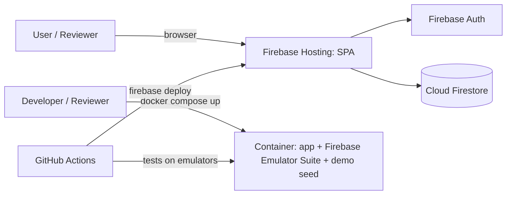

# Planner Web App: Functional Specification (User Stories)

**Project:** AI Dev Tools Zoomcamp, Project 2
**Version:** v1.0 (10 Nov 2026)
**Stack:** Firebase (Hosting, Cloud Firestore, Authentication), Docker for local run and review

---

## 1. Problem statement

People who juggle several roles (work, study, family, side projects) often plan with static to-do lists or calendars that show *what* is scheduled but not *whether it got done*, *whether the time suits the task*, or *how today's work connects to longer-term goals*. Changes such as a cancelled meeting, a holiday, or a surprise appointment mean re-planning by hand.

This app is a personal planner that:

- shows a time grid of the coming days, coloured by life area,
- matches tasks to the user's energy levels during the day,
- enforces a few personal daily rules (e.g. "at least 90 minutes of deep work"),
- checks in after each block to record whether it was done,
- links daily tasks to weekly, monthly, and quarterly goals.

## 2. Personas

| Persona | Description |
|---|---|
| **Multi-role planner** (primary) | A working professional who is also studying (e.g. a teacher doing a PhD, an engineer doing a course). Has a fixed weekly schedule (classes, meetings), daily routines, and several long-running goals. |
| **Reviewer / demo user** | Opens the demo to evaluate the app; sees only sample data. |

The app is **single user**: each account sees only its own data.

## 3. Key concepts

| Concept | Meaning |
|---|---|
| Life area | A user-defined category with a colour (default four: Work, Study, Family, Passion). |
| Task | Something to do: title, area, estimated duration, priority, optional due date, status. |
| Time block | A task placed on a date with a start and end time. |
| Routine | A repeating fixed block (meals, commute, sleep) shown in neutral grey. |
| Fixed schedule | A recurring weekly commitment (class, meeting, lab) entered once by an admin/seed. |
| Day type | Normal, Holiday, No-fixed-schedule, Online, Exam. Controls whether fixed schedule and commute appear. |
| Energy band | High / Medium / Low energy for a time range of the day. |
| Goal | An outcome for a week, month, or quarter, linked to an area and optionally to a parent goal. |
| Event | A dated item (deadline, exam, appointment, recurring series). |

## 4. User stories

Format: *As a … I want … so that …*, followed by acceptance criteria (AC). Priority: **MVP** or **Phase 2**.

### Epic A: Account and privacy

**US-A1 (MVP): Sign in**
As a user, I want to sign in with my Google account so that my plan is private and available on any device.
- AC1: Sign-in uses Firebase Authentication.
- AC2: Firestore security rules allow reads and writes only to documents under the signed-in user's id.
- AC3: Signing out clears the view.

**US-A2 (MVP): Demo mode**
As a reviewer, I want to try the app with sample data so that I can evaluate it without seeing anyone's personal information.
- AC1: A "Try demo" button signs in anonymously and loads fictional seed data.
- AC2: The repository contains only fictional seed data; real data files and keys are git-ignored.

### Epic B: Daily time grid (3-day view)

**US-B1 (MVP): See my next days at a glance**
As a user, I want an hourly grid for today and the next two days so that I can see what is planned and where I have free time.
- AC1: Grid runs from a configurable start to end hour (default 6 AM to 11 PM) in 30-minute rows.
- AC2: Today is highlighted; earlier days (if shown) are dimmed.
- AC3: Blocks are coloured by life area; routines are grey; fixed schedule items have their own colour.
- AC4: A "last updated" time is shown in the user's time zone.

**US-B2 (MVP): See my energy bands**
As a user, I want a colour strip beside the time column showing my high, medium, and low energy times so that I place hard work when I am sharpest.
- AC1: Bands are configurable per user (start, end, level).
- AC2: When a task marked "deep work" is placed in a low band, the app shows a warning.

**US-B3 (MVP): Fixed schedule appears automatically**
As a user, I want my weekly fixed commitments to appear on the grid automatically so that I don't re-enter them each week.
- AC1: Fixed schedule items are stored once (seeded in the database for the MVP; no edit screen).
- AC2: They appear on the matching weekdays unless the day type removes them.

**US-B4 (MVP): Mark special days**
As a user, I want to mark a date as Holiday, No-fixed-schedule, Online, or Exam so that the grid reflects what is really happening.
- AC1: Holiday and No-fixed-schedule hide fixed items and the commute.
- AC2: Online greys the usual fixed items, shows any online slots entered for that day, and hides the commute.
- AC3: The day header shows the day type label.

**US-B5 (MVP): One-off changes**
As a user, I want to add a substitute, extra, or cancelled session for a single date so that one-time changes don't alter my weekly schedule.
- AC1: A one-off change applies only to its date.
- AC2: If it overlaps an existing item, the app asks whether it replaces it or is extra.

### Epic C: Planning tasks

**US-C1 (MVP): Capture tasks quickly**
As a user, I want to add a task with title, area, duration, priority, and optional due date so that nothing is forgotten.
- AC1: New tasks go to a backlog list.
- AC2: Tasks can be edited and deleted.

**US-C2 (MVP): Drag tasks onto the grid**
As a user, I want to drag a task from the backlog onto the grid, then move or resize it, so that planning feels direct.
- AC1: Dropping creates a time block; moving or resizing updates it.
- AC2: Overlaps with other blocks, routines, or fixed items show a warning with options to shorten or move the other item.

**US-C3 (MVP): Daily minimums**
As a user, I want to set rules like "at least 90 minutes of deep work in area X every day" so that I can review allocation against planned mins in a weekly retrospective.
- AC1: Rules are configurable (area, minutes per day) in Planner area config.
- AC2: Daily minimums are soft metrics for weekly retrospective analysis (allocated vs planned min per area); they may deviate and do **not** block or warn while scheduling.
- AC3: The scheduler does not show shortfall badges or auto-suggest placement for missing minutes.

**US-C4 (Phase 2): Commute-friendly tasks**
As a user, I want commute or low-energy slots to accept only light tasks (listening, quick review) so that I don't plan focused work where I can't do it.

### Epic D: Tracking what got done

**US-D1 (MVP): Check in after each block**
As a user, I want the app to ask "Done / Partly done / Not done" after a block's end time so that my plan reflects reality.
- AC1: Nothing is marked done automatically.
- AC2: Partly done asks for the remaining time.

**US-D2 (MVP): Replan unfinished work**
As a user, I want partly done and not done tasks to return to the backlog flagged "replan" so that they aren't lost.
- AC1: Partly / not done on a placed block removes it from the grid and returns the task to the backlog with a replan flag.
- AC2: Partly done sets remaining minutes as the task duration; not done keeps the block duration.
- AC3: Done does not return the task to the backlog.

**US-D3 (Phase 2): End-of-day summary and energy tag**
As a user, I want an evening summary of planned versus done per area, and to tag my energy for the day, so that I can improve my energy bands over time.

**US-D4 (Phase 2): Progress log for periodic reports**
As a user, I want to add a short note when I finish a block in an area and later generate a summary of notes since a date so that writing periodic status reports (e.g. to a supervisor or manager) is easy.

### Epic E: Goals and planning horizons (3-3-3-3)

**US-E1 (MVP): Focus panel**
As a user, I want a panel with one column per life area listing my standing focus items so that I always see what matters.
- AC1: Standing focus (under Planner → Backlog) shows one column per life area (area order).
- AC2: Each column lists standing focus items (`title`, optional `subtitle`, `order`).
- AC3: Add / edit / remove items; persist locally; demo seeds fictional `focusItems`.
- AC4: No separate Focus nav page — Focus behavior lives in Planner → Backlog; Scheduler Focus layer uses Tasks to Focus (same backlog queue).

**US-E2 (MVP): Weekly goals**
As a user, I want to set a few starred goals for the week so that daily tasks serve a bigger aim.
- AC1: Goals belong to an area and an ISO week.
- AC2: Unfinished goals can be carried over to next week in one click.

**US-E3 (MVP): 3-week view**
As a user, I want to see the current week and the next two weeks as columns, with tasks assigned to a day or "sometime this week", so that I can plan beyond the next few days without fixing clock times.

**US-E4 (Phase 2): 3-month view**
As a user, I want monthly goals and milestones for the current month and the next two so that I can plan medium-term work.

**US-E5 (Phase 2): 3-quarter view**
As a user, I want quarterly objectives per area for the current and next two quarters so that I can keep long-term direction.

**US-E6 (Phase 2): Break down and roll up**
As a user, I want to break a quarter objective into monthly goals, a monthly goal into weekly goals, and a weekly goal into tasks, and see progress roll up, so that daily work connects to long-term goals.

### Epic F: Calendar and deadlines

**US-F1 (MVP): 3-month calendar**
As a user, I want a 3-month mini calendar with coloured markers for deadlines, exams, appointments, and recurring series so that I see what is coming.
- AC1: Marker colours by event type; the current week is highlighted.
- AC2: A list of upcoming events is shown below the calendar.

**US-F2 (MVP): Recurring series**
As a user, I want events that repeat on a rule (e.g. every 3 weeks, every 4 months on the 24th) so that I don't add each one by hand.
- AC1: Series are expanded when read, not stored as many copies.

**US-F3 (Phase 2): Pause a stream of work**
As a user, I want to pause a course or project so that its tasks and deadlines are hidden without being deleted.

### Epic G: Reminders

**US-G1 (Phase 2): Reminders before events**
As a user, I want a reminder before a timed event (default 1 hour) so that I don't miss it.
- AC1: Shown as an in-app or browser notification while the app is open (works on the Firebase free plan).
- AC2: Push to a closed device needs scheduled Cloud Functions (paid plan) and is optional.

## 5. Non-functional requirements

| ID | Requirement |
|---|---|
| NFR-1 | Responsive: usable on a phone for viewing and check-ins. |
| NFR-2 | Time zone per user; dates stored as `YYYY-MM-DD`, times as `HH:mm` in that zone. |
| NFR-3 | Data in Cloud Firestore; runs on the Firebase free (Spark) plan. |
| NFR-4 | Edits and drags reflect in under 200 ms (optimistic UI). |
| NFR-5 | Single user per account; security rules enforce it. |
| NFR-6 | No personal data in the repository, screenshots, or demo. |
| NFR-7 | Works offline for viewing (Firestore offline persistence). |
| NFR-8 | Automated tests run against the Firebase Emulator Suite in CI. |

## 6. Data model (Firestore)

All user data lives under `users/{uid}/...`.

| Collection | Key fields |
|---|---|
| `users/{uid}` | displayName, timezone, settings (grid hours, reminder minutes) |
| `areas` | name, colour, order |
| `bands` | level, start, end, weekdays |
| `routines` | label, start, end, weekdays, showLabel |
| `schedule` | title, start, end, weekday, kind, location |
| `dayTypes` (id = date) | type, label, onlineSlots[] |
| `scheduleChanges` | date, kind (substitute/extra/cancel), title, start, end |
| `tasks` | title, areaId, durationMin, priority, due, status, remainingMin, horizon (day/week), period, parentId?, deepWork |
| `blocks` | taskId?, date, start, end, areaId, title, status |
| `goals` | horizon (week/month/quarter), period (`2026-W46` / `2026-11` / `2026-Q4`), areaId, title, starred, progress, parentId? |
| `focusItems` | areaId, title, subtitle, order |
| `rules` | areaId, minMinutesPerDay |
| `events` | date, endDate?, kind, label, time?, seriesId? |
| `series` | label, kind, rule, startDate, paused |
| `logs` | date, blockId, areaId, note |

Indexes and rules live in `firestore.indexes.json` and `firestore.rules`.

## 7. Architecture and deployment

- **Frontend:** single-page app (e.g. React + TypeScript) with a drag-and-drop calendar grid.
- **Backend:** Firestore accessed directly from the client with security rules; optional Cloud Functions for logic that shouldn't run in the browser.
- **Docker:** production is static hosting, so Docker is used for **local run and review**. `docker compose up` starts the Firebase Emulator Suite (Hosting, Auth, Firestore) with demo seed data. No Firebase account needed.
- **Environments:** a public demo project with sample data, and private user projects; the repo defaults to the demo.
- **CI/CD:** GitHub Actions runs unit, rules, and integration tests on the emulators. **Firebase Hosting deploy is after course submission** (local run/test first); optional deploy to the demo project later.

## 8. Scope

**MVP:** US-A1, A2, B1 to B5, C1 to C3, D1, D2, E1 to E3, F1, F2.

**Phase 2:** US-C4, D3, D4, E4 to E6, F3, G1, plus PNG export of the week view and timetable import/edit screens.

## 9. Assumptions and decisions

1. Fixed schedules change rarely, so they are seeded in the database for the MVP (no import screen).
2. Reminders are in-app only on the free plan; device push is optional.
3. Single user per account; no sharing in the MVP.
4. The data model includes `horizon`, `period`, and `parentId` from the start, so the 3-month and 3-quarter views need no migration.
5. Reviewers only ever see fictional demo data.
6. **Local first:** run and test with the Emulator Suite / Docker before any cloud Hosting deploy; Hosting only after course submission.
